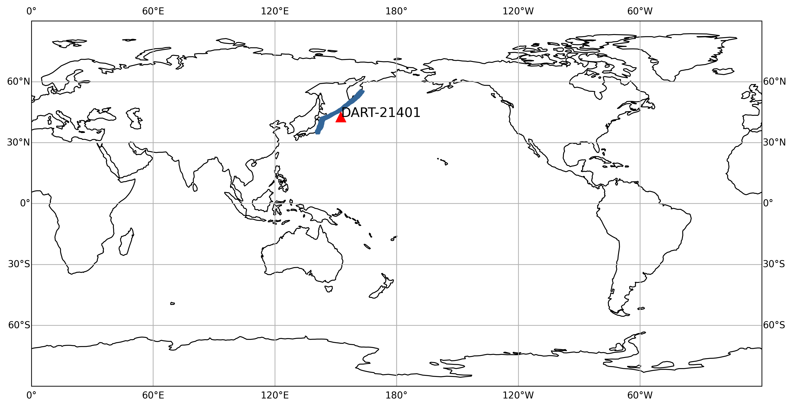
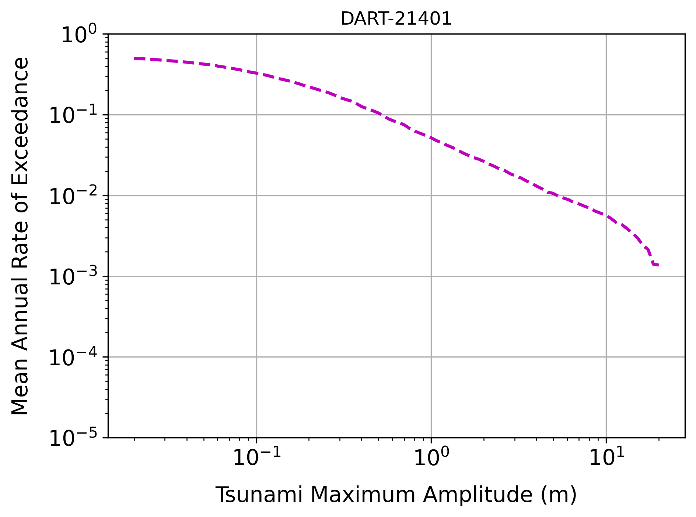

# ptha-global

**ptha-global** is a project aiming to provide a Python framework to calculate **probabilistic tsunami hazard** (maximum tsunami amplitude vs annual exceedance rate) at given Point Of Interests (POIs) from a set of subduction zones. 
The hazard is calculated starting from a list of synthetic seismic ruptures and their corresponding exceedance rates.
The list of ruptures could be provided by the user or, in alternative, could be the generated with the software [OpenQuake Engine](https://github.com/gem/oq-engine) (Pagani et al., 2014). 

***

> [!important]
> This projects contains codes and data used to provide the results described in the project [Deliverable D5.8](https://cheese2.eu/deliverables) titled "Demonstrator of PD3: Global tsunami hazard and uncertainty quantification" published in the frame of the EU-funded [ChEESE-2P](https://cheese2.eu) (the Centre of Excellence for Exascale in Solid Earth) project.
> Indeed, this workflow is set to run for one POI and one seismic source area (subduction interface) at the time.
> In the ChEESE-2P Deliverable the seismic source used is the Kurils-Japan subduction zone, which data input [^1] can be retrieved [here](https://doi.org/10.5281/zenodo.17939825) (see also this [section](#required-inputs-and-memory-storage)).
> We expect to update the codes with the ones running in parallel mode for more POIs and more seismic sources. 


## Installation
At the moment, only registered users having the access to the GitLab hosted by INGV can clone the project. All the other users can download the source code and run it locally, but they cannot create new branches to the project.    

### Openquake Engine
The workflow requires installation of OpenQuake (OQ) Engine in developer mode.
The OQ Engine installation instruction can be followed [here](https://docs.openquake.org/oq-engine/master/manual/getting-started/installation-instructions/index.html).
However, if the installation of OQ is not possible, the workflow can be run using an external file containing all the rupture parameters needed by the procedure. 
An example of this input file can be found in the `tests/example02/input` folder as it will be described [below](see #running-examples).

> [!important]
> If you use the OQ Engine, plese remember to add the folder where the EQ Engine is installed to your environemt `PATH` or `PYTHONPATH` as, for example:
`export PYTHONPATH="OQ_installation_path/oq-engine"`

### Required inputs and memory storage
To be able to run the workflow it is required to download Green’s Functions of subductions' subfaults from [here](https://drive.google.com/file/d/1oVTanG1lng6dYzGcIW5u17Qj8LEinph3/view?usp=share_link). 
Please consider that it contains information of 244 subfaults from the Kurils-Japan subduction zone, thus the size is about 6 GB for the zipped file and about 20 GB for the unzipped version. 
This repository contains all the inputs to test the workflow considering one seismic source (Kurilsjapan), and the final hazard is calculated with the contribution on this specific subduction only.  

### Required python packages

The suggested way to create a proper working environment is using `conda` (please refer [here](https://www.anaconda.com/docs/getting-started/miniconda/install) for installation).
However any user is free to install the list of required packages (see `requirements_pygptha.txt` for the list of packages) as prefer

```
conda create --name pygptha --file  requirements_pygptha.txt
```

Users who successfully installed OQ Engine should activate the environment and then install the requirements using the proper file as described in OQ documentation:

```
conda activate pygptha
(pypgtha) pip install -r OQ_installation_path/requirements_openquake.txt
```
OQ Engine requirements change depending on the operating system, so please check the correct file from the OQ Engine installation folder.

> [!note] 
> The user must remember to add the OQ Engine in the `PYTHONPATH` as indicated above.


## Getting started

To run the workflow as a script and check that the installation worked fine, please run:
```
python pygptha.py --help
```

you should get the following output:

```
usage: pygptha.py [-h] [--oq] [--save] [--plot] --subd SUBD --poi POI --input_path INPUT_PATH --output_path OUTPUT_PATH  --gf_path GF_PATH

options:
  -h, --help            show this help message and exit
  --oq                  activate openquake usage to define ruptures
  --save                save intermediate results
  --plot                activate the creation of automatic figures
  --subd SUBD           please, put subduction name
  --poi POI             please, put the poi id
  --input_path INPUT_PATH
                        please, put the path of your input folder
  --output_path OUTPUT_PATH
                        please, put the path of your output folder
  --gf_path GF_PATH     please, put the path of your greens function local folder
```


The code can be executed as:
```
python pygptha.py --subd kurilsjapan --poi DART-21416 –input_path input_folder –output_path output_path –gf_path greens_function_path  –oq
```
and the `input_path` folder should contain the following input (please refer to the `tests/example01/input` folder as example):

 - Frequency magnitude distribution (fmd) (e.g. `frequency_magnitude_distribution.npy`). The provided fmd is the one used in Davies and Griffin (2018) hazard model. The user can provide other fmds in npy format containing two arrays (magnitudes and the corresponding exceedance rates)
 - Tsunami intensity thresholds for the hazard calculation (e.g. `mih_thresholds.npy`)
 - The quadrilateral coordinates of the subfaults and the number of subfalts along strike and dip (e.g. `kurilsjapan_quadrilateral_coors.dat` and `kurilsjapan_Ntot_Nstrike_Ndip.dat`)
 - List of POIs with IDs and locations (see `POI_lon_lat_ID.txt`).

Users can provide their own version of these inputs, being careful to the required format. 

> [!tip] 
> In this example `--subd` flag should be coherent with the name of the input files that contains the coordinates of the subfaults and the number of subfalts along strike and dip  

> [!note] 
> If you encounter some issues in OQ Engine installation, you can run the version of the workflow without the OQ Engine package, and it will run with a predefined synthetic earthquake ruptures list stored in the [file](tests/example02/input/list_eq_scenario_kurilsjapan.csv). 


### Running Example 

The user can test the package by running the two examples using the two scripts contained in the tests/ folder:  

```
cd tests/
python run_example01.py greens_functions_path   # Example 01 with OQ Engine installed
python run_example02.py greens_functions_path   # Example 02 without OQ Engine installed
```

`green_function_path` is the local path where the user put the Green’s Function repository (see [Installation instruction section](#installation-instructions)). 
Example 01 uses OQ Engine to create the sources’ list, while Example 02 runs the same example using as input a given list of ruptures prepared in advance and it can be run without installing the OQ engine.
All the output will be saved in the predifined folder called `output` in the respective example folders, but user with kwowledge of python can of course customize this two scripts based on their needs.  

Running this example, to be sure that everything works properly, you should end up with both graphical/numerical output:

{ width=350px }

{ width=350px }

***


## Acknowledgment
**ptha-global** is one of the Pilot Demonstrators of the EU-ChEESE-2P Project.

## References
_Pagani, M., Monelli, D., Weatherill, G., Danciu, L., Crowley, H., Silva, V., ... & Vigano, D. (2014). OpenQuake engine: An open hazard (and risk) software for the global earthquake model. Seismological Research Letters, 85(3), 692-702._

_Davies, G., Griffin, J. (2018). The 2018 Australian probabilistic tsunami hazard assessment: hazard from earthquake generated tsunamis. Record 2018/41. Geoscience Australia, Canberra. http://dx.doi.org/10.11636/Record.2018.041__


## License
For open source projects, say how it is licensed.


[^1]: Bayraktar, H. B., Cascone, V., Romano, F., & Tonini, R. (2025). Kurils-Japan subduction Green's functions dataset [Data set]. Zenodo. https://doi.org/10.5281/zenodo.17939825
